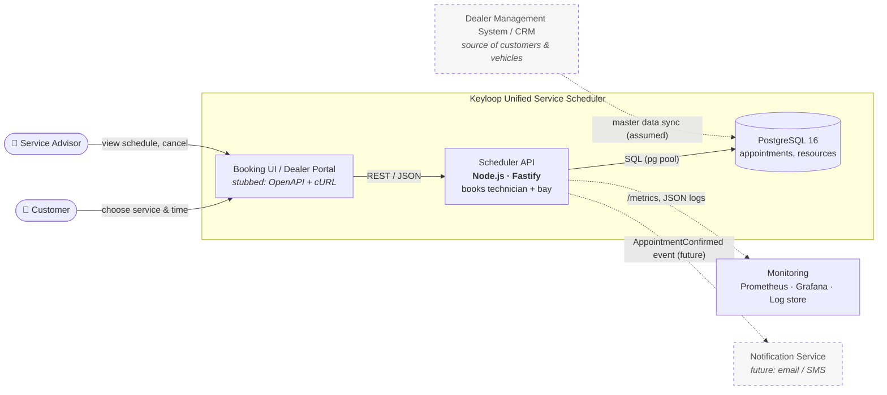
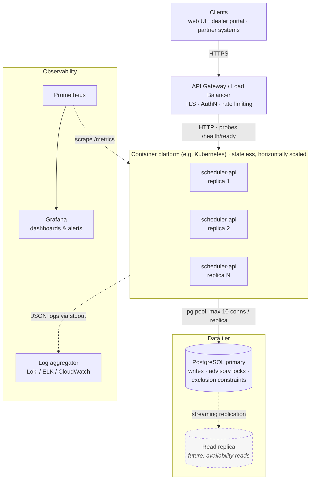
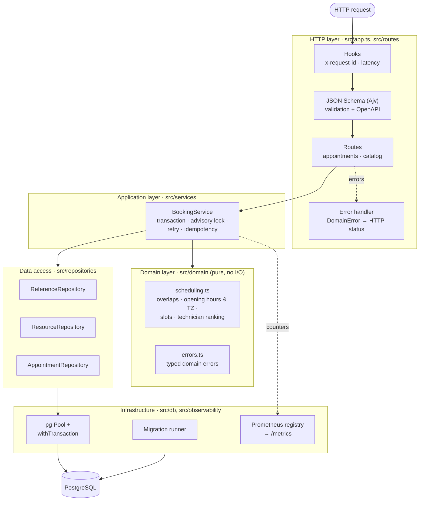
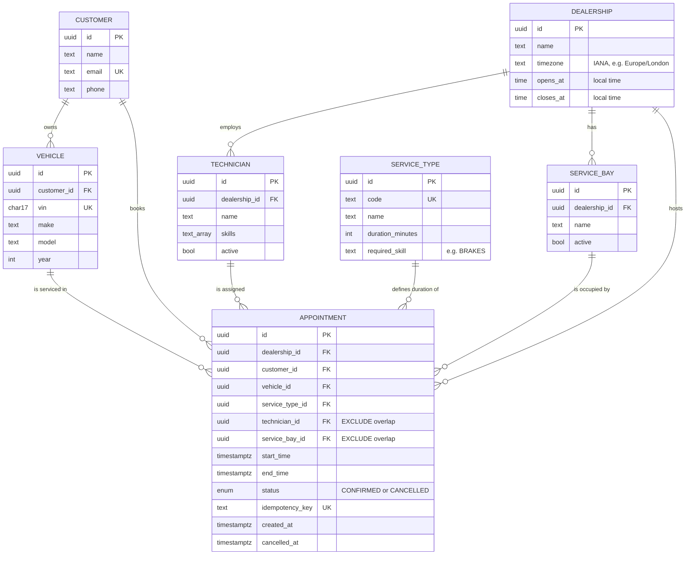
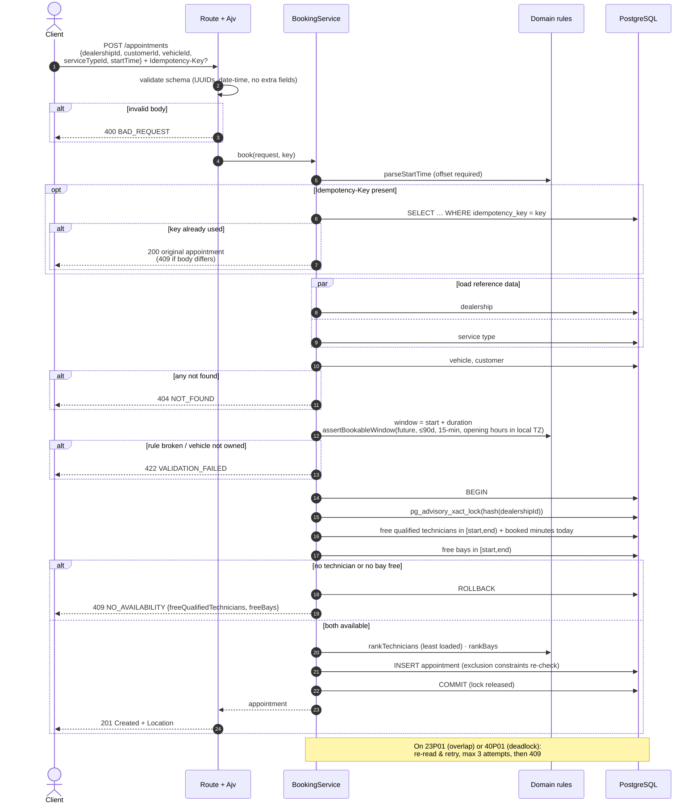
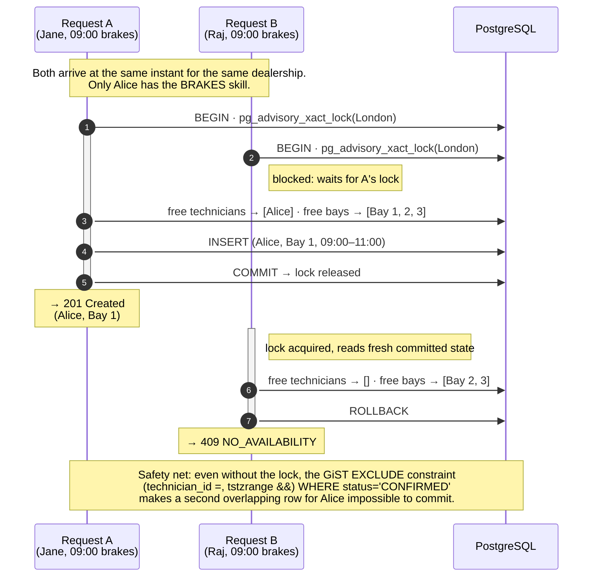
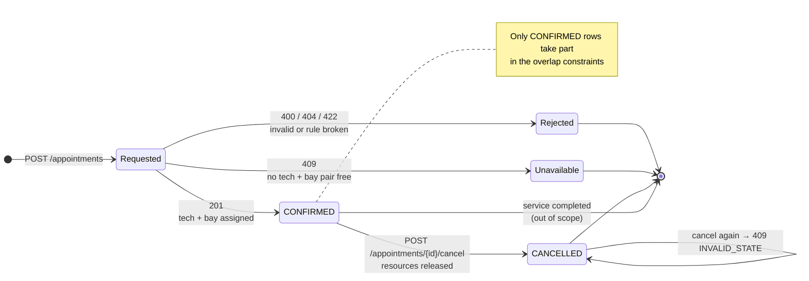

# Architecture Diagrams: Unified Service Scheduler

All diagrams are Mermaid (they render natively on GitHub). Sources are in [`diagrams/`](diagrams/), and each has a PNG
export next to it for slides and presentations. See [`SYSTEM_DESIGN.md`](SYSTEM_DESIGN.md) for the written design.

| # | Diagram | Answers |
|---|---|---|
| 1 | [System context](#1-system-context) | Who uses the scheduler and which systems it talks to |
| 2 | [Deployment view](#2-deployment-view) | Stateless API replicas behind a gateway |
| 3 | [Component view (inside the API)](#3-component-view-inside-the-api) | Layered design: HTTP → application service → pure domain rules and repositories → Postgres |
| 4 | [Data model](#4-data-model) | `EXCLUDE` constraints on `technician_id`, `service_bay_id` and `vehicle_id` (over `tstzrange(start_time, end_time)`, confirmed rows only) make double-booking impossible to store |
| 5 | [Booking flow: POST /appointments](#5-booking-flow-post-appointments) | Every check from request to confirmed record, with the HTTP status for each outcome |
| 6 | [Concurrency: two customers, one technician](#6-concurrency-two-customers-one-technician) | How the per-dealership advisory lock and the exclusion constraint together stop double-booking |
| 7 | [Appointment lifecycle](#7-appointment-lifecycle) | States an appointment request can end in |

## 1. System context

Who uses the scheduler and which systems it talks to. Dashed boxes are assumed or future integrations.

PNG: [`diagrams/01-system-context.png`](diagrams/01-system-context.png)

## 2. Deployment view

Stateless API replicas behind a gateway. Postgres is the single source of truth for locks and invariants.

PNG: [`diagrams/02-deployment.png`](diagrams/02-deployment.png)

## 3. Component view (inside the API)

Layered design: HTTP → application service → pure domain rules and repositories → Postgres.

PNG: [`diagrams/03-components.png`](diagrams/03-components.png)

## 4. Data model

`EXCLUDE` constraints on `technician_id`, `service_bay_id` and `vehicle_id` (over `tstzrange(start_time, end_time)`, confirmed rows only) make double-booking impossible to store.

PNG: [`diagrams/04-data-model.png`](diagrams/04-data-model.png)

## 5. Booking flow: POST /appointments

Every check from request to confirmed record, with the HTTP status for each outcome.

PNG: [`diagrams/05-booking-sequence.png`](diagrams/05-booking-sequence.png)

## 6. Concurrency: two customers, one technician

How the per-dealership advisory lock and the exclusion constraint together stop double-booking.

PNG: [`diagrams/06-concurrency.png`](diagrams/06-concurrency.png)

## 7. Appointment lifecycle

States an appointment request can end in.

PNG: [`diagrams/07-appointment-lifecycle.png`](diagrams/07-appointment-lifecycle.png)
