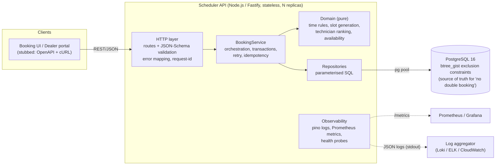
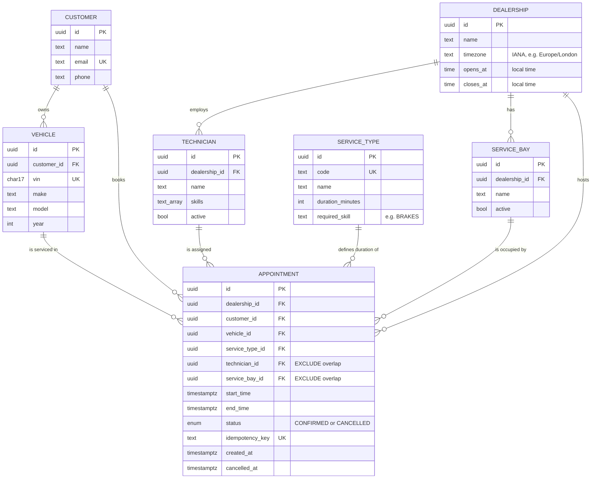
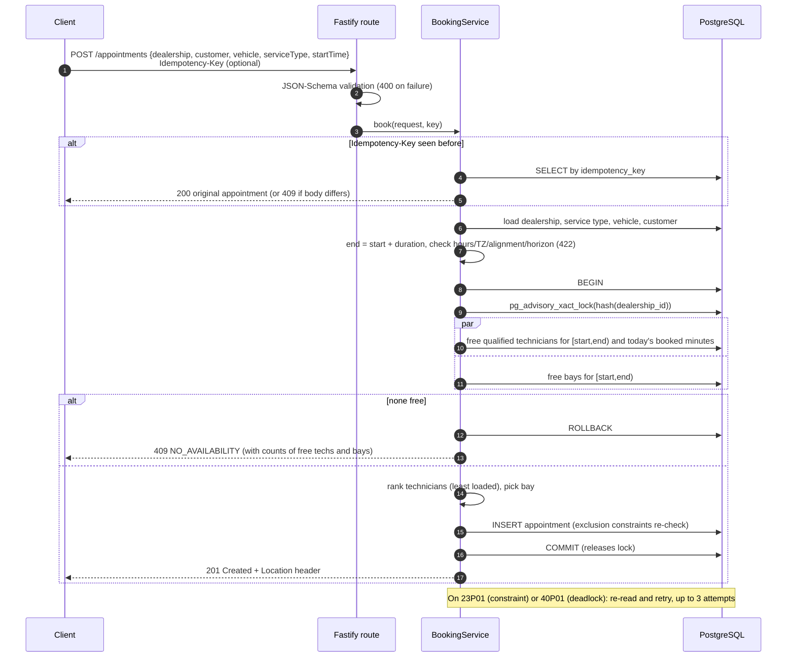

# System Design: Unified Service Scheduler

**Scenario A (Ownership domain).** Replace manual service-booking with an API that books an
appointment only when both a **service bay** and a **qualified technician** are free for the
**entire** service duration, and persists a confirmed appointment record.

**Implemented layer:** Backend (REST API + PostgreSQL). The frontend is stubbed by the OpenAPI
spec (`docs/openapi.json`, Swagger UI at `/docs`) and cURL examples (`docs/api-examples.md`).

**Full diagram set:** [`ARCHITECTURE_DIAGRAMS.md`](ARCHITECTURE_DIAGRAMS.md) covers system context, deployment,
components, data model, booking sequence, the concurrency race and the appointment lifecycle. Mermaid sources are
in `docs/diagrams/*.mmd`, with PNG exports alongside them.

---

## 1. Requirements and assumptions

### Functional (from the brief)
| # | Requirement | How it is met |
|---|---|---|
| FR1 | Request an appointment for a vehicle, service type, dealership and desired time | `POST /appointments` |
| FR2 | Check bay **and** qualified technician availability for the whole duration before confirming | Availability query and DB exclusion constraints over `[start, end)` ranges |
| FR3 | Persist an appointment linking customer, vehicle, technician and bay | `appointments` table, `status = CONFIRMED` |

Supporting features added because a real scheduler needs them: an availability grid
(`GET /dealerships/{id}/availability`), schedule listing, cancellation, and idempotent retries.

### Assumptions (the brief is intentionally ambiguous)
1. **The system assigns the technician and bay.** Customers choose *when*, not *who*. The API rejects a
   `technicianId` in the request body. The assigned technician is the **least-loaded qualified
   technician that day** (ties broken by name), to spread work fairly. Bays are interchangeable.
2. **Qualification = skill tag.** Each service type has one `required_skill` (e.g. `BRAKES`), and
   technicians hold a set of skills.
3. **Duration comes from the service type**, not from the client. The client sends only `startTime`.
4. **Time:** `startTime` must include an explicit UTC offset. Opening hours are local wall-clock times
   in the dealership's IANA timezone, so DST is handled. Starts align to 15-minute boundaries. Bookings
   must be in the future and at most 90 days ahead. The appointment must start **and finish** within
   opening hours. All dealerships open every day (no holiday calendar yet).
5. **Back-to-back is allowed.** Intervals are half-open, so 09:00–10:00 and 10:00–11:00 do not clash.
   There's no cleanup buffer between jobs (it would be a per-service-type setting).
6. **A vehicle cannot be in two overlapping appointments**, even at different dealerships.
7. **Customers and vehicles already exist** (owned by a CRM/DMS). The vehicle must belong to the customer.
8. **Authentication is out of scope** for this exercise. An API gateway would handle it in production.
9. Cancelling an appointment frees its resources immediately. Rescheduling = cancel + re-book.

---

## 2. Architecture

### Component roles
| Component | Responsibility |
|---|---|
| **HTTP layer** (`src/routes`, `src/app.ts`) | REST endpoints. Ajv validates every request against JSON Schema (types, UUID format, no unknown fields), and the same schemas generate the OpenAPI document. Maps domain errors to HTTP status codes in one consistent error envelope. Propagates `x-request-id`. |
| **BookingService** (`src/services`) | Runs the booking use case: load reference data, apply business rules, open a transaction, take the dealership lock, find free resources, insert, retry on lost races, replay idempotent requests. Records metrics. |
| **Domain** (`src/domain`) | Pure functions with no I/O: interval overlap, opening-hours and timezone rules, slot generation, technician ranking, and the slot availability calculation. Unit tested in milliseconds. |
| **Repositories** (`src/repositories`) | All SQL, parameterised. Each takes a `Queryable` (pool or transaction client), so the same code runs inside or outside a transaction. |
| **PostgreSQL** | Durable store **and** final enforcer of the core invariant through `EXCLUDE USING gist` constraints on technician, bay and vehicle time ranges. |
| **Migrations** (`src/db/migrate.ts`) | Ordered SQL files tracked in `schema_migrations`, protected by an advisory lock so several replicas can start safely. |

### Data model

---

## 3. Data flow: booking an appointment

### Why two layers of concurrency control?
A "check, then insert" flow is a classic race: two customers both see Alice free at 09:00 and
both get booked. I handle it at two levels:

1. **Per-dealership advisory lock (correctness and liveness).** Bookings for one dealership run
   one at a time for the few milliseconds of the read-then-insert step, so every request reads
   fresh state and picks a resource that really is free. Different dealerships never block each
   other, so throughput scales with the number of dealerships, and a single dealership sees few
   bookings per minute.
2. **Exclusion constraints (safety net).** `EXCLUDE USING gist (technician_id WITH =,
   tstzrange(start,end,'[)') WITH &&) WHERE status='CONFIRMED'` (and the same for bay and vehicle)
   make double-booking *impossible to store*. This holds even for a buggy future code path, a manual
   SQL fix, or a second service writing to the table.

**Found during verification:** the first version used only layer 2 (optimistic retry on `23P01`).
A test firing 12 parallel requests at one slot (capacity 3) passed most runs but intermittently
produced only **1** booking plus 500 errors. Postgres logs showed `deadlock detected`: concurrent
inserts waiting on each other's uncommitted rows in the exclusion index. Adding layer 1 removed the
deadlocks, and the suite then passed 25/25 runs, dropping from about 13s to about 3s.
`40P01` is also treated as retryable for the cross-dealership vehicle case.

### Other flows
* **Availability grid:** generates candidate starts within opening hours, loads qualified
  technician ids, bay ids and the day's booked intervals in **3 parallel queries**, and computes
  availability in memory with the pure `computeSlotAvailability` function (no N+1 queries).
* **Cancel:** `UPDATE … WHERE status='CONFIRMED'`. Constraints apply only to confirmed rows, so the
  resources free up immediately. A second cancel returns 409.

---

## 4. Technology choices

| Choice | Why |
|---|---|
| **Node.js 22 + TypeScript (strict)** | Non-blocking I/O suits an I/O-bound API. Strict types (`noUncheckedIndexedAccess`) catch nulls at compile time. One language across a future React frontend. |
| **Fastify 5** | Fast, with built-in **JSON-Schema validation**, **pino structured logging** and request ids. Route schemas also produce the **OpenAPI** spec, so docs cannot drift from the code. |
| **PostgreSQL 16** | The key requirement (no overlapping time ranges per resource) is expressed natively with range types and **GiST exclusion constraints**, enforced transactionally. Few databases can do this. ACID transactions and advisory locks cover the rest. |
| **`pg` with hand-written SQL (no ORM)** | The core logic relies on Postgres features (ranges, `&&`, exclusion constraints, advisory locks) that ORMs hide or don't support. The SQL is small, parameterised and kept in repositories. |
| **Luxon** | Correct IANA timezone and DST arithmetic for opening hours. Native `Date` cannot do this safely. |
| **prom-client** | De-facto Prometheus client for Node. Its npm successor, `@prometheus-io/client`, is still 0.x, so I chose the stable API and noted it as a follow-up. |
| **Vitest** | Fast TypeScript-native tests. Integration tests use Fastify's `inject()` (no network port) against a real Postgres, because the core guarantees live in the database and mocking it would test nothing. |
| **Docker / Compose** | One-command Postgres for development and tests, plus a multi-stage, non-root production image. |

---

## 5. Non-functional design

**Scalability.** The API is stateless and scales horizontally behind a load balancer. All shared
state lives in Postgres. The lock is per dealership, so contention is bounded by one dealership's
booking rate, not total traffic. Indexes: `(dealership_id, start_time)`, plus the GiST indexes behind
the constraints, which also speed up overlap queries. Next steps at larger scale: read replicas for
availability and listing, a short-TTL availability cache invalidated on booking, and partitioning
`appointments` by month.

**Performance.** Booking takes about 5 queries inside one short transaction. The availability grid
takes 3 parallel queries plus in-memory computation. Connection pooling (max 10 per replica) with
timeouts. Booking latency is tracked by a histogram, and observed latency locally is about 10 ms.

**Reliability.** ACID transactions, with rollback on any error. Bounded retries on lost races.
**Idempotency keys** make client retries safe; this is also safe under concurrency (unique index plus
replay on `23505`, covered by a test). Liveness and readiness probes, graceful shutdown on
SIGTERM/SIGINT, and migrations guarded by an advisory lock.

**Maintainability.** Layers (routes → service → domain/repositories) keep business rules pure and
testable. A single error type hierarchy maps to HTTP codes. The schema doubles as validation and
docs. Strict TypeScript throughout.

**Security (baseline).** All SQL is parameterised. Strict input validation rejects unknown fields. The
container runs as non-root. Errors never leak stack traces. Authentication and authorization, plus
rate limiting, belong at the API gateway (out of scope, listed below).

---

## 6. Observability strategy

| Signal | Implementation | Use |
|---|---|---|
| **Structured logs** | pino JSON to stdout, every line tagged with `reqId`. Business events: `appointment confirmed` (ids, technician, bay, attempt), `appointment cancelled`, `booking lost a race … retrying`. Domain rejections log at info, unexpected errors at error with the stack. | Ship to Loki, ELK or CloudWatch. Query by `reqId` or `appointmentId`. |
| **Correlation** | Accepts an inbound `x-request-id` (or generates a UUID), echoes it in the response header and every error body. | Join gateway, API and DB logs for one request. Support staff can quote the id from an error. |
| **Metrics** (`GET /metrics`) | `http_request_duration_seconds{method,route,status_code}` histogram; `scheduler_booking_requests_total{outcome=confirmed\|replayed\|no_availability\|rejected\|error}`; `scheduler_booking_conflict_retries_total`; `scheduler_booking_duration_seconds`; Node default metrics (event loop lag, heap, GC). | RED dashboards. **Alerts:** error outcome rate above 1%; p95 booking latency above 250 ms; sustained rise in `no_availability` (a capacity signal for the business); spikes in conflict retries (lock or contention problem). |
| **Health** | `/health/live` (process up), `/health/ready` (runs `SELECT 1`, returns 503 if the DB is down). | Kubernetes probes and load balancer health checks. |
| **Tracing (next step)** | Add OpenTelemetry auto-instrumentation (`@opentelemetry/instrumentation-fastify`, `-pg`), using `x-request-id` / W3C `traceparent` for propagation, exported over OTLP to Tempo or Jaeger. | See how booking time splits across queries and lock waits. |

---

## 7. How GenAI was used in the design phase

I used an AI coding agent (Claude Code) as a design partner and implementer, keeping the decisions
and the verification myself.

* **Reading the brief and choosing a scenario.** I had the agent summarise the four scenarios and
  compare them by design depth. Scenario A came out ahead because it has a real concurrency problem
  (two resources that must both be free over a time range), which tests design judgement more than CRUD.
* **Stack choice.** I specified Node. The agent proposed Fastify and Postgres. I accepted Postgres
  specifically because exclusion constraints turn the core invariant into a database guarantee rather
  than application code that hopes it wins races.
* **Pinning down ambiguity.** The assumption list in section 1 was drafted with the agent and then
  reviewed: who picks the technician, whether back-to-back bookings conflict, timezone handling, and
  whether a vehicle can be double-booked.
* **Challenging the design with tests, not trust.** The first concurrency design (optimistic insert
  plus retry) looked right on paper. I had the agent write a 12-way parallel race test and **run the
  suite repeatedly** rather than once. It failed intermittently. Postgres logs showed deadlocks, which
  led to the two-layer design in section 3. This was the most valuable moment of the exercise: the AI's
  first design was plausible but wrong under load, and only adversarial testing exposed it.
* **Version and dependency hygiene.** The agent checked the registry instead of guessing versions. I
  chose TypeScript 5.9 over the brand-new 7.0 and kept `prom-client` despite its deprecation notice
  (its successor is still 0.x). Both decisions are documented above.

---

## 8. Out of scope and future work
* AuthN/AuthZ (OAuth2/JWT at the gateway), per-dealership tenancy checks, rate limiting.
* Holiday calendars, technician shifts and breaks, per-bay capabilities (e.g. EV lift), cleanup buffers.
* Rescheduling as one atomic operation. Waitlists. "Next available slot" suggestions in the 409 response.
* Outbox pattern publishing `AppointmentConfirmed` / `AppointmentCancelled` events for notifications and the DMS.
* OpenTelemetry tracing, an availability cache, and read replicas.
